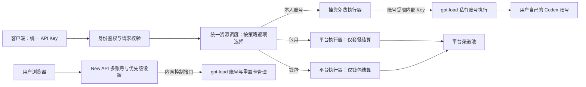

# Oak 免费账号挂靠：产品方案与实施记录

更新时间：2026-11-01 16:12:11 +00:00。用户已明确每个 Key 独立排序，并否定共享 gpt-load 管理凭据。第 2 节保留实施前调研基线，实际代码、配置与验证边界见第 14 节。

上一版挂靠已部署；本文本轮修订已在本地 new-api / gpt-load 工作区实施，尚未提交、推送或部署。真实原厂 OAuth、Codex 客户端与重置机会消费尚未验证；本地自动化验证不替代上线验收。

## 1. 推荐结论与已确认范围

**推荐同一个 Oak API Key 共用“资源使用优先级”：用户在每个 API Key 下分别排序自己的挂靠账号、包月额度和钱包，系统按顺序选择能够执行本次请求的来源。New API 负责统一调度与结算，gpt-load 负责私有账号执行及额度观测。用户无需换 Key 或修改客户端地址。** 不额外部署 CLIProxyAPI、sub2api 或新的中间业务服务。

用户本次已确认：

- 首期仅支持 **ChatGPT/Codex 订阅账号**；验证后再加入 Claude。
- 挂靠为**免费附加服务**：实际由挂靠账号完成的调用不扣平台额度；依用户设置回退到包月或钱包时，按实际来源正常结算。
- **同一个 Key 共存多种资源，顺序可调整**，如“挂靠账号 → 包月 → 钱包”或“包月 → 挂靠账号 → 钱包”，不足时自动尝试后续来源。
- 同一用户可以挂靠**多个 Codex 账号**，分别查看每个账号的额度，并使用账号本身已有的额度重置机会。
- 前台基于 New API，账号执行和技术管理基于 gpt-load。
- 规划确认后，用户已明确授权实施；生产部署与真实耗卡不在本轮执行范围。

账号面板参考 sub2api 的管理体验，面向用户重新精简。首期支持添加多个 Codex 账号、逐账号查看额度与重置卡、为客户端选择使用哪个账号；不把“一个用户”限制成“一个账号”。本人多个账号也可排序，额度不足时自动尝试下一账号或下一类平台资源。重置卡仍需手动确认，不因回退自动消耗；团队共享不在首期范围。

### 四种业务如何共存

| 业务 | 用户使用什么 | 费用或额度来源 | 本次范围 |
| --- | --- | --- | --- |
| 量贩 Token | 平台提供的模型资源 | Oak 钱包，按模型价格与倍率计算 | 纳入统一顺序，保留价格与付款规则 |
| 包月 | 平台套餐提供的模型资源 | 套餐周额度；每周 150 元是产品示例 | 纳入统一顺序，不重做套餐购买及周期重置 |
| 账号挂靠 | 用户自己的 Codex 账号 | 用户原厂订阅额度；Oak 收费 0 元 | 本次实施重点 |
| 代充值 | 上游提供的外部账户充值卡密 | 独立卡密订单与兑换说明 | 不实施；不能复用钱包兑换码冒充 |

同一用户及同一个 Key 可以同时使用前三种资源，不新增互斥业务类型。优先级借鉴 Auto 的排序交互，但排序的是资源来源，不是擅自更换请求模型。外部充值卡密仍是独立商品，不属于请求来源。

## 2. 当前项目与线上事实

### 2.1 工作区概览

Oak 根目录是包含四个独立 Git 仓库的工作区，根目录自身不是 Git 仓库。已核对四库入口、目录职责、项目规则、已有记忆及与挂靠相关的实际调用链；没有把历史文档或功能宣传当作运行证据。

| 仓库 | 调研时本地提交 | 当前角色与结论 |
| --- | --- | --- |
| `new-api` | `0ba93af29d95`，`oak` | Go + React 用户门户、认证、API Key、模型网关、钱包、订阅、支付、发票；无用户私有挂靠模型 |
| `gpt-load` | `2af0ad77b6e5`，`oak` | Go + Vue 技术管理与执行层；有订阅 OAuth、Group、Credential、AccessKey、额度观测；无 Oak 用户归属 |
| `CLIProxyAPI` | `ad8bdd3f20be` | OAuth、执行器、协议转换与调度参考；gpt-load 已依赖 CPA 及其嵌入模块，无需再部署一套 |
| `sub2api` | `f178e5ae3265` | 账号管理、额度窗口、健康状态及重新授权体验参考，不替换已确定技术选型 |

New API 已有四服务官网介绍、订阅续费、独立官方付款、人民币充值和人工开票。挂靠的官网按钮仍到采购咨询，不是自助接入。gpt-load 当前部署说明也明确用户隔离与挂靠功能尚未实现。

### 2.2 本轮只读核对 wdm

| 检查 | 实际结果 |
| --- | --- |
| systemd | `new-api`、`gpt-load`、`caddy`、`postgresql`、`redis-server` 均 active |
| New API 当前发布目录 | `/opt/new-api/releases/oak-1ee1e4614cc0-41281034436-1` |
| gpt-load 当前发布目录及 `/health` 版本 | `oak-2af0ad77b6e5-41287707116-1`，健康响应为 ok |
| gpt-load 监听 | `127.0.0.1:3001`；Codex 回调监听 `127.0.0.1:1455` |
| 服务器内存 | 约 1706 MiB 总内存，检查时约 940 MiB available；不能据此推导业务并发容量 |

本地 New API 提交与线上发布版本不同，后续必须以待发布代码及数据库实际状态重新预检。New API 的 3000 端口当前绑定通配地址；历史部署依靠防火墙限制访问，本轮没有重新验证公网暴露情况。挂靠发布前须确认外部入口只能通过预期的 HTTPS 入口。

本轮没有读取业务凭据、导出数据库、发起真实 OAuth/模型请求或验证上游连通性；服务 active 和健康接口成功不等于挂靠可用。未核实线上已有账号、AccessKey 或渠道数量，实施前需只读盘点，不能假设数据库为空。

### 2.3 决定架构的源码发现

1. **New API 分组是共享资源池，不是用户私有空间。** 用户只有一个 `Group`，渠道没有账号所有者；按 group + model 选择渠道。为所有用户配置同一个“挂靠组”会串用资源。
2. **gpt-load 空分组筛选表示允许全部。** 不只新 Key，任何旧的 `groups=[]` Key 都可能获得未来新增的私有账号；必须在执行层补私有资源隔离。
3. **免费不能只靠零倍率。** New API 部分鉴权检查 Key/钱包额度；缺少 BillingSession 的结算会退回旧钱包路径。普通 relay 与价格、重试、自动禁用深度耦合。
4. **账号唯一性目前只在单个 Group 内成立。** 同一 OAuth 身份可进入多个组，刷新锁又按 Credential ID 划分，可能并发刷新同一账号；需要跨组保护。
5. **现有 Codex 授权仅声明浏览器 OAuth 与文件导入。** 回调为固定 localhost，不能直接换成 Oak 域名，也不能把通用 device-poll 接口视为 Codex 已支持设备码。
6. **上游额度观测已经比较完整。** 可读取窗口、重置时间、更新时间和未知状态；它与 Oak 包月金额、gpt-load 参考成本是三种不同数据。

实际文件与行号集中在第 13 节，便于实施时追踪。

## 3. 用户看到什么，怎样最省事

### 3.1 导航与信息归属

保留当前模型广场、API Key、用量、钱包等入口；新增一级入口 **“账号挂靠”**。首期不大改整个导航，也不另建四套控制台。官网“账号挂靠”按钮在功能上线后进入此工作区，匿名用户先登录并回到原页。

| 页面 | 用户任务 | 首期内容 |
| --- | --- | --- |
| 账号挂靠 `/hosting` | 管理多个账号及额度 | 我的账号列表、逐账号上游额度/重置机会、模型测试、重新授权、暂停与解绑 |
| API Key `/keys`（已有） | 集中管理客户端权限 | 每个 Key 菜单提供额度使用顺序和 Codex 接入配置；保留模型/IP/有效期和付费支出限制 |
| 使用日志（已有） | 解释请求结果与消耗来源 | 实际来源、账号或套餐、回退原因、套餐消耗或钱包扣款、真实 Token 或未知状态 |
| 钱包（已有） | 量贩充值、包月购买和账单 | 不加入挂靠购买卡片，不把上游额度混入钱包 |
| gpt-load 管理页 | 管理员排查执行问题 | 识别私有账号归属引用、健康、凭据刷新、路由故障；只由管理员访问 |

New API 管用户、业务权限和财务；gpt-load 管模型账号及执行。管理员仍需两处职责明确的后台，不能让 gpt-load 承担它当前没有的用户和支付管理。

### 3.2 挂靠首页草图

以下仅为页面布局示意，数值和账号不是实际数据：

```text
账号挂靠                        免费服务   [+ 添加账号]
使用自己的 Codex 订阅，通过 Oak API 接入客户端。
筛选：[全部状态 ▼]                         [刷新额度]

账号       状态    上游额度窗口    重置卡       操作
工作账号   可用    按实际数据展示  次数/到期    [使用][管理]
备用账号   限额    按实际数据展示  次数/到期    [重置额度]
研究账号   失效    上次数据/时间   暂未知       [重新授权]

账号详情：额度窗口 / 可用模型 / 重置记录 / 调用记录
挂靠成功：平台费用 0 元；回退平台时按实际来源计费。

[管理 API Key] → 选择具体 Key 的菜单
  [额度使用顺序]  工作账号 → 备用账号 → 包月 → 钱包
  [Codex 接入配置]  当前 Key 的已验证模型、地址、复制配置
```

无账号时只显示一张引导卡与“连接 Codex 账号”按钮，不先显示空报表。手机上先呈现状态和“开始使用”；次要操作收进菜单。状态不能只靠颜色，加载、空状态、失败和数据过期必须区别展示。

桌面端采用紧凑账号表，手机端改为逐账号卡片。每行显示别名、脱敏身份、可验证套餐、各额度窗口、重置次数及最近同步时间；余额/积分与重置卡分开显示。不要把不同账号的百分比相加成一个“总额度”，也不要为了展示列表同时无限并发刷新所有上游账号。复用缓存、按可见账号加载、对手动刷新节流。

### 3.3 参考 sub2api 的连续接入流程

1. 填写账号备注，点击“生成授权链接”，完成现有敏感操作验证后生成链接。
2. 点击“打开授权页面”或复制链接，到模型商页面登录。用户不向 Oak 提交密码或管理员 Key。
3. 将授权结束后的完整 localhost 回调地址粘贴回专用表单。该地址可能显示无法连接；Oak 只解析回调，不访问用户填入的 URL。
4. 点击“完成授权并添加账号”。异步授权完成后自动延续本次添加动作，不要求用户再次点保存；保存失败使用原授权编号重试，回调响应丢失先只读查询，不盲目重发 code。
5. 成功显示“账号已添加”，随后可进入账号详情主动测试模型，再到 API Key 菜单配置消费顺序和客户端。授权成功不等于模型调用已验证，不自动发送耗额测试。

服务配置不完整或就绪查询失败时，页面显示原因与重试，禁用新连接/重新授权。就绪检查仅验证本地必需配置，不是上游或执行层健康保证。首期不开放文件导入；浏览器表单不把回调保存在 localStorage 或 URL 中。

### 3.4 同一个 Key 的资源优先级

每个 Key 独立保存完整顺序，不设用户全局优先级或继承开关。例如 A Key 先挂靠再包月，B Key 先包月再钱包；编辑任意一个不会影响另一个。未配置的 Key 继续既有平台计费，用户显式添加和保存后才进入新策略。

```text
资源使用顺序                          拖动排序 / 启用或停用
1. 我的 Codex · 工作账号              原厂额度，Oak 免费
2. 我的 Codex · 备用账号              原厂额度，Oak 免费
3. 包月套餐额度                       消耗套餐额度
4. 钱包余额                          按模型价格与倍率扣款

当前来源不足时按顺序尝试下一项。
钱包已启用：前序资源不足时可能产生钱包扣费。
[保存优先级]
```

- 新策略建议本人账号 → 包月 → 钱包；没有挂靠账号时是包月 → 钱包。用户可自由排序，也可把某个备用账号放在包月之后，或关闭某项只用免费账号。
- 每个账号、包月、钱包在同一顺序中最多出现一次；未开通套餐显示“未开通”，不阻止其他来源。未授权、不支持当前模型的账号不能因为排序靠前而被选中。
- 钱包是否启用本身就是量贩回退授权；移除钱包后不扣钱包，不再设置一个与顺序冲突的隐藏回退开关。保存时展示价格入口与 Key 付费预算；实际 API 调用不逐次弹窗。
- 地址和 Key 不变，调整策略对新请求生效，在途请求使用开始时的版本。不同工具可分别设置策略，无需建立互斥 Key 类型。
- 模型目录取策略中具备权限和能力的模型，并标注来源/临时可用性；不因瞬时余额耗尽把模型全部隐藏。客户端模板只展示验收通过的协议，避免重复 `/v1`。
- 明确请求的模型保持不变，只更换执行来源；本次不新建自动替换不同模型的 `Auto` 模型。未来模型层 Auto 应先选定模型，再进行来源调度。
- 暂停/删除一个账号后统一 Key 仍可使用其他来源，确认框提醒可能使用套餐或扣钱包。停止全部调用应停用 Key；避免付费应停用策略中的付费来源。
- 无任何来源可用时返回可理解原因，不自动开通套餐、充值或耗重置卡。回退边界见第 5.2 节。

### 3.5 用户管理动作

| 动作 | 界面与行为 |
| --- | --- |
| 修改备注 | 仅修改本人显示名称，不改上游身份 |
| 刷新额度 | 刷新观测，不是刷新登录令牌，更不是购买或重置额度 |
| 使用重置卡 | 展示该账号剩余机会和到期信息，二次确认后消耗一次原厂重置机会；不收费，不自动连续消耗 |
| 测试连接 | 用户主动触发，有节流、超时和可定位请求编号；提示会用少量原厂额度 |
| 重新授权 | 同身份原位更新；授权成了另一账号时提示不匹配，不偷偷换绑 |
| 暂停/恢复 | 新请求跳过暂停账号，其他来源仍按策略运行；恢复前检查归属与状态 |
| 解除挂靠 | 展示受影响策略及可能的付费回退；禁止再选择此账号，统一 Key 仍可使用其余资源 |

解绑只移除 Oak 保存的凭据，不等于撤销模型商侧授权。界面给出到原厂撤销授权的说明，不虚假显示“已撤销原厂授权”。不展示挂靠到期或续费按钮；原厂订阅到期仅在有可信数据时显示。

### 3.6 原厂重置卡操作

这是功能 3 的账号维护操作，**与功能 4 售卖的充值卡密无关**，用户不用输入卡号或密码。

1. 先读取选中账号的额度与 `reset_credits_available`，有可信到期列表时展示最近到期及展开详情；未知和零张区别显示。
2. 点击“使用 1 次重置机会”，确认框显示账号别名、脱敏身份、当前额度和“将消耗一次原厂机会，无法撤回”。不能承诺所有额度窗口都会恢复，也不提供上游不支持的任意选卡/选窗口。
3. Oak 建立持久操作 ID，校验本人归属及敏感操作权限，再调用 gpt-load。提交期间禁用重复点击；多个页面/Key 对同账号的消费也须串行。
4. 显示“已确认重置 / 上游拒绝 / 暂无可用机会 / 结果待确认”。超时不能写成“失败，未扣次数”；结果未知时保留原操作 ID，不允许通过换 ID 再扣一张。
5. 成功后刷新该账号的额度、重置卡与状态。若消费成功但刷新失败，显示“重置已成功，额度待同步”，不再消费一次。保存可查询的无秘密操作记录。

首期仅手动逐账号重置；不做多账号批量重置、自动耗卡或重置卡售卖。普通“刷新额度”永远不能调用重置消费接口。

可复用的执行接口已经存在：`POST /api/groups/:group_id/credentials/:credential_id/reset-credits/consume`，请求体 `{}`，必须携带小写 UUID v4 格式的 `Idempotency-Key`。Codex 上游接收 `redeem_request_id`，没有卡密、金额或选卡字段。gpt-load 已持久化 `prepared / succeeded / rejected / outcome_unknown` 状态；Oak 只补用户归属、操作映射和展示，不重写消费状态机。

调研时 gpt-load 没有独立的操作结果 GET 接口，本轮已补只读查询入口供 Oak 对账。Oak 的状态 GET 只读本地投影或远端已存结果；“继续确认上次操作”使用独立 POST、复用原 UUID，不能在 GET 中重新执行消费。原结果尚未知时继续原操作与新增消费严格区分。

当前主额度查询成功不保证重置卡详情成功：Codex 驱动对重置卡详情失败仍可能返回主额度。因此要扩展重置卡子结果的状态、更新时间/错误码，前端分别显示“次数未知 / 到期详情未知”，不能统一按主观测 fresh 显示，也不能把缺失数量默认成 0。消费成功且 `observation_pending=true` 时显示“重置成功，额度同步中”，只刷新观测。

## 4. 状态、额度与异常如何解释

把“用户是否暂停”“授权是否有效”“某模型是否限额”“数据是否新鲜”分别存储，由前端组合成主状态；不要用一个 status 覆盖所有事实。

| 可见状态 | 用户解释与下一步 |
| --- | --- |
| 正在连接 | 授权尚未完成，可继续或取消 |
| 已连接，待验证 | 身份已接入，尚未验证真实模型调用 |
| 可用 | 最近验证通过；展示验证时间，不承诺永远可用 |
| 已暂停 | 用户主动关闭，点击恢复 |
| 需要重新授权 | 登录凭据失效或刷新结果不确定，进入授权向导 |
| 模型额度已用尽 | 展示受影响模型和上游返回的重置时间；其他模型不自动判为失效 |
| 上游暂不可用 | 展示请求编号和可重试建议，不建议充值 Oak 钱包 |
| 额度暂无法获取 | 保留上次数据及时间并标记过期，不显示“剩余 100%”或“无限” |
| 正在解除/清理失败 | 已禁止调用；后台继续清理，允许查看原因和重试 |

额度区使用原厂实际返回的窗口及单位，例如短周期、周窗口或模型专属窗口；没有窗口就不编造。不能把它们转换为“每周 150 元”。OAuth token 过期时间不是订阅到期日。

用量区明确区分：

- **原厂额度**：可能包含官方应用和其他客户端的消费。
- **经 Oak 调用量**：只统计 Oak 可见请求；缺失 usage 时显示未知或不完整。
- **实际消费来源**：挂靠成功为 0 元；包月记录套餐消耗；钱包记录量贩扣款。gpt-load 参考成本不作账单。记录实际来源与每次切换原因，不能只显示“自动”而隐藏扣款。

## 5. 实现架构与责任边界



### 5.1 统一调度，按实际来源执行与结算

Key 负责身份和访问限制，策略负责来源顺序，每次执行尝试负责实际资源和结算。来源同时决定“用哪个账号/渠道”与“消耗哪份额度”，不能在挂靠账号上扣平台钱包，也不能平台执行后声称免费挂靠。

1. **公共鉴权**：保留用户/Key 的真实禁用、过期、IP、模型权限和总请求限流。将 TokenAuth/ValidateUserToken 的货币额度耗尽检查移至付费候选；钱包或 Key 付费预算为零仍可尝试挂靠。区分历史 exhausted 与主动禁用，不能误恢复已撤销 Key。
2. **策略解析**：只读取当前 Key 的独立策略，冻结 revision；解析模型、协议并展开本人账号及有权限的平台来源。原 Group/AutoGroups 继续约束平台渠道，不承担挂靠所有权判断。
3. **逐项选择**：判断能力、权限、账号状态与来源额度。挂靠观测未知不等于耗尽，可刷新或正常尝试一次；过期的耗尽缓存不能永久跳过已重置账号。包月/钱包以真实事务预留结果为准，不仅查页面余额。
4. **冻结尝试**：创建独立 attempt 上下文，固定 request_id、attempt_id、policy_revision、source_kind、账号或订阅 ID、平台 group/channel、价格快照、BillingSession、是否已发送/已输出。换来源必须新建上下文，不能只改一个 RelayInfo.BillingSource。
5. **执行**：挂靠候选走不进入收费链的 HTTP/SSE 执行器；平台候选复用现有 relay，但只能使用指定 funding source。复用校验、传输、定价、预扣结算和日志，不另造价格系统。
6. **成功或前进**：成功只结算实际来源。满足第 5.2 节时，先确认释放失败尝试的全部预留，再尝试下一来源。释放失败、结果未知时停止并可定位，不能重复预留或盲目退款。

调度入口放在普通 Distribute / RouteTaskPluginEndpoint 之前，成为唯一跨来源决策点。执行器应在响应未提交时返回结构化的额度拒绝等结果；不能把 429 写给客户端后再尝试回退。SSE/正文一旦开始写出就不能跨来源重试。

**需要修改的现有计费边界：**

- NewBillingSession 目前依据 BillingPreference、AllowWalletOverflow 再次回退。新策略必须调用“仅创建指定 funding source”的路径，复用 WalletFunding/SubscriptionFunding；不临时修改用户设置，也不让内部渠道重试改变资金来源。
- 当前 Refund 存在异步无结果路径，预扣失败的部分回滚也可能只记日志。新调度需要可确认结果的同步中止/释放契约与幂等操作；钱包退款不能盲目重试。订阅预扣幂等键须区分 attempt，避免同 request_id 已退款后无法正确再次预留。
- 新策略请求发送前按价格快照真实预留，不能绕过钱包预扣；同来源渠道重试价格变化时补足预留。实际 usage 超过估计仍归原来源结算，异常可观测，不在输出后偷偷换钱包补差。
- 首期包月与钱包继续使用现有可访问平台模型池，区别在扣款来源；现有订阅预扣未按 modelName 筛选，用户 Group 又可能被订阅改变，不能声称已经支持套餐独立模型池。若产品需要套餐专属模型，须另立并验证套餐与模型路由合同。

旧 Key 不需要更换。启动迁移在事务中把旧用户全局顺序原样复制到其现存、未配置独立策略的 Key，保留已有 Key 策略，排除软删除 Key，然后删除旧全局记录；重复启动幂等。新建 Key 不再继承旧全局顺序。没有策略记录的 Key 保留既有平台合同；显式保存空顺序则拒绝全部来源。删除策略的 API 明确恢复既有平台合同，当前界面不展示恢复继承按钮。

gpt-load 仍是一账号一私有 Group、一 Credential、一受限内部 AccessKey，不为每个账号再创建 New API Channel。内部 Key 不交用户，不能与统一公网 Key 混为一谈。gpt-load 只在被选账号内执行，跨本人账号/包月/钱包的选择全部由 Oak 负责。

### 5.2 “不够了再用下一项”的精确定义

建议按**完整请求**选择来源，不把一次输出拆成“前半段套餐、后半段钱包”。

| 情况 | 处理 |
| --- | --- |
| 来源未配置、账号已暂停/解绑、无有效套餐、本来源不支持请求模型/协议 | 跳过并记录原因，全局模型权限仍须满足 |
| 额度不足本次预留或 Key 付费预算不足 | 确认释放已产生的预留后尝试下一来源 |
| 挂靠有可信且未过重置时间的耗尽状态，或上游明确额度拒绝且确认未执行 | 可依序尝试本人下一账号、包月或钱包 |
| 观测未知/过期 | 不当作耗尽；刷新或允许一次正常尝试 |
| 上游 429 | 仅适配器能明确识别为额度拒绝且未执行时回退；普通限速不是额度不足 |
| 用户/Key 被禁用或过期、全局限流、非法请求、无模型权限 | 全局拒绝，不能换来源绕过 |
| 授权失效、401/403 | 标记账号待处理，本次不直接转付费；之后请求可跳过已确认不可用账号，界面明示 |
| 网络超时、5xx、断连或执行结果未知 | 停止本次请求，不盲目重放/付费回退 |
| 已开始输出、工具已产生、成功后结算异常 | 不换来源，不重放；处理原来源结算 |

“账号 A → B → 包月 → 钱包”的保存即表达对上述顺序回退的授权。余额非零但不足本次预留也算不足；不承诺先用完套餐最后几分钱再对同一输出跨来源补差。日志展示跳过原因、最终来源与实际消费。

预留是估计，不保证最终额度一定足够；超额结算仍用冻结来源并按现有契约处理不足/异常，须验证真实并发和异常结算，不能通过换来源掩盖。

普通无状态请求每次按当前顺序评估，额度重置后重新优先使用前排来源。`previous_response_id` 等上游句柄必须绑定原来源，不能跨账号/平台续接；无法安全回退时明确失败，不删除字段伪装兼容。缓存、粘性路由和模型别名不能越过权限或策略。

原厂重置卡保持独立手动操作。一个外部请求的限流与并发限制覆盖所有尝试；候选只遍历有限次，不循环重试到已失败来源。

### 5.3 首期协议边界

| 接口/行为 | 计划 |
| --- | --- |
| `GET /v1/models` | 策略来源能力取并集，再与用户/Key 权限相交；标明来源与暂不可用状态 |
| `POST /v1/responses` HTTP/SSE | 核心必验；文本、工具调用、多轮完整输入和取消 |
| `POST /v1/responses/compact` | Codex 客户端验收前置核查项；必须验证 gpt-load 实际路由与客户端行为，未通过不宣称完整 Codex CLI 支持 |
| `POST /v1/chat/completions` | 转换兼容项；完成工具调用、流式和多轮验收才开放模板 |
| WebSocket、Realtime、图片、文件、批任务、异步任务、Responses 资源读取/删除 | 首期未实现统一来源链；未启用新策略的旧请求保留原合同。已启用新策略的请求明确拒绝不支持路径，不能绕过其禁用钱包等限制回到旧链路 |

gpt-load 的 Codex 声明包括 stateless Responses，不能推断完整有状态资源 API 可用。首期优先全量输入和显式无持久存储的交互；`previous_response_id` 等续接机制若不能证明用户、账号、Key 的作用域隔离，应明确拒绝，并确保已发布客户端模板不依赖它。不能默默删掉字段导致上下文丢失。

SSE 必须及时 flush、传播客户端取消、保留协议终止事件；响应开始后不重试。过滤 hop-by-hop、内部调试、Set-Cookie 等不适合下发的头；保留安全的限流信息和请求编号。连接故障与上游业务错误分开记录，敏感错误内容脱敏。

## 6. 数据设计与跨服务一致性

以下为建议模型，实施时以现有 ORM、状态视图和事务约定落地，不直接操作另一服务数据库。

### 6.1 New API

| 数据 | 最小字段/约束 | 可信来源 |
| --- | --- | --- |
| `hosting_accounts`（新增） | id、user_id、provider、alias、身份指纹、脱敏身份、远端资源引用、生命周期、暂停状态、最近错误/同步时间；同用户可有多个同厂商账号，稳定上游身份不能重复挂靠 | user_id 从登录会话取；可信身份验证需补齐，不能直接信任现有 JWT 解码结果 |
| `hosting_authorizations`（新增） | 不透明本地 ID、user_id、provider、用途（新接入/重授权）、原账号 ID、stage_id、expires_at、状态、操作幂等标识 | Stage 由 gpt-load 生成，Oak 维护归属映射；不保存 PKCE/Refresh Token |
| `resource_policies` | user_id + token_id 唯一；revision、有序 sources JSON；来源为本人账号 ID、subscription 或 wallet | 必须绑定本人正数 Key；缺行是旧平台合同，空数组是禁用全部 |
| `hosting_reset_operations`（新增） | operation_id、user_id、account_id、上游幂等标识、状态、结果摘要、时间；一账号同时最多一个未决消费操作 | 与 gpt-load 的持久幂等结果对齐，不是支付订单；未知结果不得当未消费 |
| 现有日志（扩展） | source_kind、账号/订阅 ID、policy_revision、request_id/attempt_id、回退原因、usage 完整性、实际消费 | 挂靠成功费用 0，平台按冻结来源计费；不保存提示词和凭据 |

内部 AccessKey 若由 New API 保存，必须使用服务端持久加密密钥加密，管理接口不返回明文；不复制上游 OAuth 凭据。统一 Key 保留有效期、IP、模型、请求速率和付费预算；付费预算不能阻断免费挂靠，“免货币计费”不等于无限并发。

不新增挂靠套餐、支付订单、有效期、续费、钱包流水或额度换算表。免费调用仍需资源保护；建议试运行每用户最多 5 个 Codex 账号、用户合计并发 2、每分钟 30 次，作为待确认初始值，随后按真实容量和上游限制调整。用户合计限制不能通过增加账号或 Key 绕过；限制对用户可见，超限返回 429。

### 6.2 gpt-load

建议新增最小内部挂靠资源绑定（如 `HostingBinding`），记录 Oak 用户/账号的不透明引用、Group/Credential/AccessKey ID、provider 与稳定身份指纹。该映射进入运行快照，使调度和模型列表都能识别私有组，而不是靠 `oak-user-*` 名称判断。

- 私有组只有与绑定对应、显式列举该组的内部 Key 可用；空组 Key、其他内部 Key、普通平台 Key 均不允许进入。
- 管理员在原有组/凭据/Key 接口修改挂靠资源时，也须遵守单凭据、Key 范围与不可随意换所有者的约束。允许禁用与排障，不允许普通编辑绕过归属校验。
- 私有绑定的 provider + 稳定身份全局唯一。查重必须覆盖已有普通组的同身份记录；普通组导入也不能绕过现有私有绑定。存量冲突先报告，不自动搬移或合并。
- 并发创建使用数据库唯一约束和事务保证，不依赖“先查一下”。身份不从用户输入的邮箱或未验证的 JWT 文本取值。
- 重新授权保持身份不变并原位更新凭据；沿用现有 SecretVersion/CAS 和刷新状态，不在 Oak 再实现刷新任务。

需要补齐的现有缺口：Codex `identity.go` 当前仅解码 JWT 元数据、不验证签名；文件导入还可能在 Stage 阶段立即刷新即将过期的凭据。阶段 A 必须验证可信身份获取方法；未验证的文件不能占用最终唯一身份或激活账号。Stage 刷新前也要查已有身份/凭据指纹并串行处理同身份，不能等创建 Group 才查重。无法可靠实现时首期关闭文件导入，仅保留通过受控换码流程并验证身份的浏览器授权。

建议新增窄范围内网业务入口，将已有 Stage、幂等组创建和 Key 创建能力组合起来；使用挂靠专属请求授权，固定由 New API 调用；不共享执行层管理员密钥。不提供“替用户访问任意 `/api/*`”的透明代理，也不为了这次工作扩建一套通用多租户管理系统。

### 6.3 创建与失败恢复

1. Oak 创建 `provisioning` 记录和稳定操作 ID；此时不能路由。
2. gpt-load 按同一操作 ID 消费本人授权 Stage，原子检查身份、建立私有绑定及最小权限资源，数据面保持 pending/disabled。
3. Oak 持久保存完整远端引用和加密内部 Key，再以同一操作 ID 确认激活；核对模型可见性后标记已连接，真实调用通过后再标记已验证。确认响应丢失可重复查询/确认，不能重复创建资源。
4. 控制请求超时视为“结果未知”，以原操作 ID 查询或重试，不生成另一套账号。两边数据库不做分布式事务。
5. 应用重启后由已有后台任务机制恢复未完成状态；清理或同步失败保持可见，不假装成功。远端孤儿资源保持禁用，管理员可追踪到操作 ID。

重新授权、暂停、恢复也要有幂等语义和新请求即时校验。候选及模型缓存按用户、策略 revision、Key 权限区分；最终校验拒绝已停用账号，其他来源仍按策略运行。

### 6.4 解绑顺序

Oak 先标记 deleting、阻止新请求选择该账号（统一 Key 仍可使用其余授权来源）→ gpt-load 禁用内部 Key/账号 → 删除 Key 或解除引用 → 删除私有组及凭据 → 清理账号业务记录与临时授权材料。不能把最后一个组从 Key 里删到空数组；空数组不是“无权限”。

建议普通暂停/解绑先阻止新请求，不主动强杀已开始的流；不承诺删除凭据后在途调用一定完成。现有 gpt-load 删除接口没有排空等待，本方案不隐含承诺“等全部流结束再删除”。若必须可靠等待或立即断开所有流，需额外账号级在途登记与控制，本期不默认增加。

有未决重置时先禁新调用，暂缓删除原 Group、Credential 和操作记录，界面显示“已停用，等待上次重置结果确认”。现有消费接口在重放前仍需要读取原组/凭据，仅保留操作表不足以继续确认。以同 UUID 查明结果后再删除；若用户要求立即清除凭据，应明确未决结果只能保留为 unknown，之后不得再调用上游消费或声称可继续恢复。不能删除记录后以新 UUID 重试。

删除不可能即时擦除历史备份，需在隐私说明写明实际保留策略；上线前确定备份与日志保留期。当前尚无周期/异机备份，发布前至少建立可恢复的成套备份并验证恢复步骤。

## 7. 对外接口与权限建议

以下全部是**拟新增的 Oak 接口**，不是当前可调用接口。浏览器只提交 Oak 资源 ID，不提交 gpt-load group_id/credential_id。

| 接口 | 用途与关键限制 |
| --- | --- |
| `GET /api/hosting/accounts` | 只返回本人账号安全摘要 |
| `POST /api/hosting/authorizations` | 发起新绑定或重授权；首期 provider 仅 codex，限速且绑定当前用户 |
| `GET /api/hosting/authorizations/:id` | 仅本人轮询授权进度，不返回 PKCE/秘密 |
| `POST /api/hosting/authorizations/:id/callback` | 校验归属、用途、TTL、state、redirect 形状和单次使用 |
| `POST /api/hosting/authorizations/import` | 高级文件导入，限格式/大小，不落普通日志 |
| `DELETE /api/hosting/authorizations/:id` | 取消本人未完成授权 |
| `POST /api/hosting/accounts` | 消费本人的有效授权结果并幂等创建绑定 |
| `PATCH /api/hosting/accounts/:id` | 仅备注与暂停状态；不接受 owner、provider 或远端资源 ID 修改 |
| `POST /api/hosting/accounts/:id/test` | 主动真实连接测试，有独立限速 |
| `POST /api/hosting/accounts/:id/refresh-observation` | 刷新额度读数，不消耗原厂重置机会 |
| `POST /api/hosting/accounts/:id/reset-credits/consume` | 消耗一次本人账号原厂机会；幂等、单账号串行、敏感操作验证，返回 operation_id |
| `GET /api/hosting/reset-operations/:id` | 查询本人操作状态；只查询已有结果，不能把读取实现为再次消费 |
| `POST /api/hosting/reset-operations/:id/resume` | 在原操作结果未知时继续确认，复用原 UUID，不创建另一笔消费 |
| `GET /api/hosting/accounts/:id/models` | 返回本人账号可用模型及协议能力 |
| `DELETE /api/hosting/accounts/:id` | 立即禁止新请求并返回清理状态，不提前宣称清理完成 |

Key 创建/撤销与日志扩展现有 API，不建第二套 Key 系统。`GET/PUT /api/hosting/tokens/:token_id/policy` 管理当前 Key 的完整顺序；原全局接口已经移除。保存使用 revision 并发校验，不能写入他人账号或由旧页面覆盖新顺序。新增路由同步 New API 的 PAT 范围契约；“控制台个人访问令牌”与“模型调用 API Key”权限分开。涉及授权、凭据导入、换绑/解绑、重置卡消费等敏感操作，复用既有近期验证/单次验证和 CSRF 防护，不能只加前端确认框。

授权材料仅在 gpt-load 加密存储；浏览器授权会话与 Oak 用户、provider、操作类型、原账号绑定，state/PKCE 单次且有时效。回调不能由别人接管，重新授权不能换成别人账号。失败信息不暴露其他用户是否挂靠了某个邮箱。

gpt-load 已有可复用接口：Stage 授权/回调、Group 创建、单凭据详情与 `observation-refresh`、AccessKey 管理、重置卡消费。此次需补的是私有绑定原子操作、全路径归属约束、重置结果只读查询与重置卡子状态；不重新实现这些接口背后的厂商通信。用户每个请求都由 Oak 将本地账号 ID 转为经校验的远端资源，禁止透传用户给出的组/凭据 ID。

## 8. 管理员怎样管理

用户归属和挂靠启停从 Oak 业务接口维护；gpt-load 分组管理增加 **“平台资源 / 用户挂靠”分类**，用户挂靠分类支持按 Oak 用户、厂商、账号状态筛选，按用户折叠展示其多个账号，每个账号仍是一条独立私有 Group。分类由绑定关系计算，不允许编辑分类就转移所有者。

管理员看到用户引用、账号备注、上游状态/额度/重置次数、关联 Key、最近调用与未决操作，不显示用户密码。平台分组和用户挂靠分组在调度、Key 授权、模型枚举上均隔离；分类是管理视图，`owner + account + key scope` 才是权限边界。管理员不能靠编辑组名转移账号。

首期管理员关注账号总数、可用/失效数量、授权失败、额度观测失败、上游 429/5xx、正在清理资源和同步失败；不增加面向普通用户的 gpt-load 登录入口。

运营可停用滥用账号；挂靠封禁与用户全站封禁需区分，普通免费服务限制不能意外冻结用户钱包。凭据导出、全局代理、上游地址和管理密钥继续限管理员；用户只能经 Oak 对本人账号使用原厂重置机会，不能直接取得管理 API 权限。管理员也必须走同一账号级幂等消费逻辑，避免与用户同时操作重复耗卡。

业务侧失败率和延迟按 provider/错误类型聚合，日志保留 request_id、账号内部 ID、模型、时长和必要的错误码。默认不记录提示词、输出正文、OAuth code、完整回调、原厂 token 或完整身份信息。

## 9. 实施拆分与代码落点

| 阶段 | 要做的事 | 退出标准 |
| --- | --- | --- |
| A：能力验证 | 隔离测试环境用获授权测试账号，核对可信身份、Stage 刷新、授权、额度/重置卡、模型发现、HTTP/SSE、工具调用、compact 与实际 Codex 客户端 | 形成实际能力矩阵；真实耗卡另获明确授权，不以只读查询代替消费验证 |
| B：执行层隔离 | gpt-load 私有绑定、内部幂等入口、身份唯一性、私有组/Key 门禁、管理编辑约束 | A/B 用户与空过滤 Key 不能越权；并发绑定与删除恢复通过 |
| C：统一来源链路 | 策略/统一鉴权、来源调度、挂靠执行器、平台显式 funding、可靠释放预留、回退日志 | 同 Key 自动顺序回退；零余额可挂靠；无误扣/重复扣，已输出不跨来源重试 |
| D：用户体验 | 多账号工作区、授权向导、逐账号额度/重置卡、配置导出、每 Key 资源顺序、回退日志和官网链接 | 用户可接入多个账号、测试、调用、手动重置、暂停、重授权、解绑；手机/键盘可完成流程 |
| E：发布验收 | 迁移矩阵、两服务版本兼容、备份恢复验证、测试账号闭环、真实客户端回归 | 再向普通用户开放，保留故障恢复步骤 |

阶段 A 是能力门槛，不是再次选择技术栈。compact、网络或客户端行为不满足时，先明确修复或产品限制，再完成 C/D；不先发布“完整支持”再补验证。

建议代码归属：

- New API：`model/hosting_*.go` 管数据；`service/hosting/` 管 gpt-load 内网客户端与业务编排；`controller/hosting*.go` 管用户接口/转发；新增统一来源选择服务；既有鉴权、Token 和协议路由接入统一调度，`service/billing_session.go` 支持显式来源与可确认退款。
- 前端：`web/src/features/hosting/` 与对应 TanStack 路由；扩展已有 keys、usage-logs、导航及客户端导出。复用现有复制、弹窗、表格和状态组件，沿用 i18n。
- gpt-load：在既有 storage、control、state/loader、scheduler 和 gateway 模型目录中加入最小私有绑定与权限；统一调度与模型枚举的私有组判定，覆盖现有多个空筛选放行入口。凭据刷新、协议转换、额度和重置卡驱动继续复用；分组 UI 加用户挂靠分类。
- 测试按公共行为归属放入已有测试体系；按项目要求保持中文有效注释密度与交接文档，不复制一套 OAuth/计价/调度实现。

两服务保持当前原生 systemd 部署与数据库分离，gpt-load 继续回环监听。先发布含隔离能力、默认尚无挂靠流量的 gpt-load，再发布与其契约匹配的 New API；开启用户入口前检查所需内部接口版本。旧 gpt-load 不支持契约时返回不可用，不静默改用管理 Key 或旧无隔离接口。

每次 `oak` 推送都会触发部署，包括文档提交；本轮不提交或推送。未来数据库迁移后不能只切换旧二进制回滚，必须遵循已有发布与备份恢复规则。

## 10. 验收清单

### 用户闭环与优先级

- 同一 Key 按 A → B → 包月 → 钱包依次回退，验证实际执行账号与资金流水；改为包月优先立即影响新请求，停用钱包后任何回退均不扣钱包。
- 每 Key 隔离、并发保存、在途策略快照、旧全局顺序向现存 Key 等价迁移正确，不扩大既有扣费授权；缺少套餐或模型能力能正确跳过。
- 零余额/零付费预算仍可使用挂靠，真实禁用、过期、封禁、IP/模型权限仍全局拒绝。删除一个账号不废弃统一 Key，可能付费回退的提示清楚。
- 多账号额度/重置次数独立，真实 Codex CLI 的流式文本、工具、多轮、compact 与模型目录/配置模板一致，手机与键盘操作通过。

### 隔离、退款与来源切换

- 跨用户读写/排序/授权/重置均拒绝；gpt-load 空组 Key 和其他账号内部 Key 不得调用私有资源；缓存/粘性/别名不绕过。
- 同身份跨组、并发 Stage 导入、管理员导入与自动刷新受约束；未验证身份不占用账号。
- 实际挂靠成功不改变钱包/套餐/Key 货币额度；平台成功只结算冻结来源；新策略不被旧 BillingPreference/AllowWalletOverflow 二次改写。
- 预留不足、部分预留回滚失败、释放响应丢失、重复释放、订阅 attempt 幂等、同时争用最后额度、实际 usage 超预留、输出后结算异常均有回归；不得误扣或重复退款。
- 明确额度拒绝可前进；普通限流、非法请求、未知超时/5xx、已输出、工具已产生不得跨来源重放。候选总尝试有界且不绕过全局限流。
- 上游状态句柄跨账号/平台续接拒绝，无状态完整输入可按顺序调用；策略变更不改变在途结算归属。
- 重置卡的无卡/未知/过期、双击、管理员并发、超时未知、成功但观测失败、重启确认均正确；资源回退不自动耗卡。
- OAuth state/PKCE、过期/重放、身份绑定、敏感操作和日志脱敏覆盖真实路由。

### 协议与运维

- JSON/SSE、取消、慢上游、显式零值及缺失 usage 正确；日志解释实际来源、回退原因和费用，不编造用量。
- 跨服务创建/删除的中断与补偿可恢复，无启用孤儿资源；备份恢复不会再次消耗已完成的重置机会。
- New API 验证 SQLite/MySQL/PostgreSQL 的新安装、升级与重复迁移；gpt-load 验证生产 SQLite 及受影响数据库合同。
- 两服务测试、类型/lint/构建及受影响独立模块验证通过；原定价、支付、续期及周期重置行为回归通过。
- 实测多账号和跨来源尝试的延迟/内存/错误率，再确定容量；备份含两服务数据及密钥，恢复后保持权限与消费记录。

业务验收的本地执行结果与尚需真实账号验证的项目见第 14 节；前文包含原始验收目标，不能将未运行的生产验收项视为通过。

## 11. 明确的能力边界与待验证事实

1. **首次授权的网络条件**：日常 Oak API 可由服务器访问上游；官方登录页仍由用户浏览器访问，不能承诺授权全过程不需要额外网络条件。服务器出口可用性也必须在阶段 A 实测。
2. **订阅不是通用 API 余额**：OpenAI 官方文档区分 ChatGPT 订阅登录和 API Key 按量访问。本方案只规划 gpt-load 已实现的 Codex 订阅接入，不承诺 ChatGPT 网页全部能力、所有模型或所有接口。
3. **设备码**：官方 Codex 文档有设备码方式，但当前 gpt-load Codex 模块未声明该方式。首期不把它列为已具备功能；要改善授权体验需单独验证和实现。
4. **厂商可用性与允许范围**：源码能适配不代表原厂长期支持第三方托管。应核实用于试运行账号的实际权限和适用授权范围；本轮官方认证文档不能证明托管用途获准。
5. **Claude**：按用户选择后置。本轮 Anthropic 官方相关页面抓取返回 403，未确认其当前第三方 OAuth 使用政策；后续接入前重新核对，不以参考库存在执行器推断可直接上线。
6. **价格与周额度**：价格、套餐购买/续期与周期重置保持原规则；模型调用的来源优先级及预留/退款衔接需要改造，不能声称完全不碰计费。原厂限额不等于“周额度 150 元”。

## 12. 已批准的实现取舍与待实测参数

已确认免费挂靠、Codex 首期、多账号与原厂重置机会，以及**同 Key 共存多来源、顺序可调、不足时自动回退**。原互斥 Key 类型和必须手动换绑的提案已撤回。

用户已授权按以下取舍实现；试运行容量仍需部署环境实测：

1. 每个 Key 独立配置完整顺序，不提供全局继承；启用钱包即允许量贩回退。新策略建议本人账号 → 包月 → 钱包，旧 Key 不静默扩大扣款范围。
2. 一次完整请求选一个来源，不足预留时整次换下一来源；不跨来源拼账，未知执行结果或已开始输出时不重放。
3. 浏览器授权为主，文件导入在安全验证后开放；重置卡仍手动确认。试运行 5 个账号/合计并发 2/RPM 30 是待实测调整的建议值。

本轮已完成本地开发；发布与真实账号验收状态见第 14 节。

## 13. 源码与官方资料索引

行号针对第 2 节提交，代码变化后以函数和实际实现为准。下表路径相对 Oak 工作区；本文件位于 `new-api/docs/plans/`。

| 证据 | 文件与定位 |
| --- | --- |
| 单用户 Group、Token 当前字段与货币额度校验 | `new-api/model/user.go:79`；`new-api/model/token.go:14,243` |
| 普通渠道选择及分流入口 | `new-api/service/channel_select.go:114,283`；`new-api/middleware/distributor.go:34,631` |
| 通用 relay 的预扣、重试、重新设置渠道 | `new-api/controller/relay.go:160,177,314,325` |
| Responses 注册位置、响应后计费 | `new-api/router/task-plugin-protocol-router.go:29`；`new-api/relay/responses_handler.go:81` |
| 结算旧路径与钱包校验 | `new-api/service/billing.go:63,103`；`new-api/service/billing_session.go:394,402`；`new-api/service/quota.go:440` |
| 模型目录与计费配置过滤 | `new-api/controller/model.go:188,251,259`；`new-api/controller/user.go:624` |
| 退款完成性及资金幂等边界 | `new-api/service/billing_session.go:88,232,436`；`new-api/service/funding_source.go:68,122` |
| 现有订阅和全局计费偏好 | `new-api/controller/subscription.go:74`；`new-api/model/subscription.go:146,364,1354` |
| PAT 范围、本人日志、导航与客户端导出 | `new-api/middleware/access_token_routes.go`；`new-api/controller/log.go:75`；`new-api/web/src/hooks/use-sidebar-data.ts`；`new-api/web/src/features/keys/components/dialogs/cc-switch-dialog.tsx` |
| gpt-load 管理鉴权、Key 过滤与空组语义 | `gpt-load/internal/control/auth.go:57,210`；`gpt-load/internal/control/access_keys.go:24`；`gpt-load/internal/scheduler/inspect.go:278` |
| gpt-load 模型可见性也需隔离 | `gpt-load/internal/gateway/models.go:173` |
| Group/Credential 结构、组内身份唯一性 | `gpt-load/internal/storage/models/group.go:13,61,65` |
| Codex 协议、授权方式与固定回调 | `gpt-load/internal/channel/modules/codex.go:17`；`gpt-load/internal/subscription/providers/codex/driver.go:104`；`gpt-load/internal/control/oauth_callback.go` |
| Stage、同身份重授权与刷新锁 | `gpt-load/internal/control/credential_stages.go:27,790,1442`；`gpt-load/internal/subscription/credential_manager.go:139` |
| 观测字段与用量权限 | `gpt-load/internal/control/credential_observations.go:46,65,89`；`gpt-load/internal/control/usage.go:124` |
| 现有重置卡接口、持久幂等与副作用 | `gpt-load/internal/control/http_routes.go:352`；`gpt-load/internal/control/credential_reset_credits.go:29,406,535`；`gpt-load/internal/storage/models/credential_reset_operation.go:12`；`gpt-load/third_party/cpaembedded/embedded/embedded.go:702,711` |
| 身份未验签与卡详情独立失败 | `gpt-load/internal/subscription/providers/codex/identity.go:53`；`gpt-load/internal/subscription/providers/codex/driver.go:165,185` |
| 可复用控制接口、幂等创建与删除依赖 | `gpt-load/internal/control/http_routes.go:57,285,322,482`；`gpt-load/internal/control/group_idempotency.go:41`；`gpt-load/internal/control/access_key_idempotency.go`；`gpt-load/internal/control/group_delete.go:77` |
| 参考库的 localhost 授权和回调校验 | `CLIProxyAPI/sdk/auth/codex.go:27,158,186`；`CLIProxyAPI/internal/api/handlers/management/oauth_callback.go:100` |
| 参考库的额度窗口与授权会话 | `sub2api/backend/internal/service/account_usage_service.go:147,183,242`；`sub2api/backend/internal/service/openai_oauth_service.go:47,135` |
| 用户指定的账号面板及重置卡交互 | `sub2api/frontend/src/views/admin/AccountsView.vue:316,1823`；`sub2api/frontend/src/components/account/AccountUsageCell.vue`；`sub2api/frontend/src/components/account/OpenAIQuotaResetCell.vue:1,111,450,488` |
| 参考库的原厂重置与积分区别 | `sub2api/backend/internal/service/openai_quota_service.go:25,69,79,341`；不要照搬每次手动请求生成新 UUID 的消费行为，优先复用 gpt-load 持久幂等 |

相关项目文档：[New API 产品记忆](../memory/product.md)、[New API 部署说明](../../deploy/oak/README.md)。gpt-load 的产品记忆和部署说明分别位于其仓库 `docs/memory/product.md`、`deploy/oak/README.md`。

本轮实际读取的官方资料：

- [OpenAI Codex 认证](https://developers.openai.com/codex/auth/)（访问时跳转至 [官方认证文档](https://learn.chatgpt.com/docs/auth)）：订阅/API Key 区别、localhost 回调、设备码及凭据敏感性。官方客户端能力不自动等于 gpt-load 已适配能力。
- [OWASP Authentication Cheat Sheet](https://github.com/OWASP/CheatSheetSeries/blob/master/cheatsheets/Authentication_Cheat_Sheet.md)、[Session Management Cheat Sheet](https://github.com/OWASP/CheatSheetSeries/blob/master/cheatsheets/Session_Management_Cheat_Sheet.md)、[OAuth2 Cheat Sheet](https://github.com/OWASP/CheatSheetSeries/blob/master/cheatsheets/OAuth2_Cheat_Sheet.md)：官网抓取受限后读取官方仓库原文，作为会话、敏感操作与 OAuth 绑定的设计依据。

实施涉及认证时还须依仓库规则核对届时稳定版 OWASP ASVS，并记录实际适用条款与测试结果；本规划未宣称 ASVS 合规认证。


## 14. 本地实施结果与上线交接

### 14.1 已接入的业务链

- New API `/hosting` 多账号工作区：浏览器授权、脱敏身份、额度窗口、重置机会与到期信息、主动测试、暂停、重授权、解绑。授权绑定用户和当前认证会话，敏感动作使用既有单次证明；个人访问令牌另受 `hosting.manage` 权限约束。
- 每个 Key 独立保存完整顺序；空策略禁止全部来源，删除策略恢复既有平台计费。旧全局顺序按原值迁移到现存未覆盖 Key，之后删除全局行。采用 revision 冲突校验，不静默覆盖其他页面保存的顺序。
- `TokenAuth → 总请求限流 → ResourceRelay`，免费挂靠不进入平台计费链。已测试 active 账号才参与调用，额度为零的 Key 仍可调用本人免费账号；禁用、过期、IP 和模型限制继续有效。
- 包月和钱包通过请求级显式来源冻结计费，关闭信任额度旁路。统一策略使用同步持久化的预留、结算和退款，不受 `BatchUpdateEnabled` 的延迟写入影响；退款或提交结果未知时终止，不重复加额或继续下一来源。
- `/v1/models`、单模型查询和控制台 Key 配置目录使用同一权限交集；平台协议按用户可用分组与实际渠道路径生成，不从全站目录借用其他组能力，图片/向量/任务模型不会混入同步文本目录；挂靠无需配置平台模型价格。已验证标记绑定具体模型及 `openai-responses` 协议，不能从授权成功推导整个目录已验证。
- 消费日志保存实际来源、账号 ID、策略版本和发送前跳过原因；挂靠费用为零，未解析的原厂 token 用量明确显示未知。前台和 CSV 不将 unknown 当真实零用量。
- gpt-load 私有组、凭据与内部 Key 绑定；普通空分组 Key、其他账号 Key 不能调用私有账号。后台有资源分类与归属搜索；分类本身不承担权限验证。
- 未完成创建/删除由既有系统任务租约恢复，不自动建立新授权或消耗重置机会。重置未知状态只读查询与显式同 UUID 恢复分开，新 UUID 不能绕过未决操作。

### 14.2 实际支持边界

统一策略首期支持同步 `POST /v1/chat/completions`、`POST /v1/responses`、`POST /v1/responses/compact` 和 OpenAI 模型目录。WebSocket、图片、任务插件、后台异步生成、`previous_response_id` 持久续接及 Responses 资源读取/删除明确拒绝；没有启用新策略的旧 Key 保留原合同。需要完整上下文的客户端应使用无上游持久状态的请求方式。

来源回退以发送前事实为准：暂停/删除/待验证、不支持模型、平台额度不足，或 **fresh 且不超过 60 秒、适用于当前模型、尚未到重置时刻的明确耗尽观测**。重置后标为 stale 的旧快照不能用于跳过免费账号。gpt-load 当前没有可信“尚未执行”响应标记，所以 429、5xx、超时或断流会结束当前请求，不在另一个来源重放；下一请求重新读取执行层最新缓存。客户端收到失败后也不应盲目重复带外部副作用的工具调用。

账号数量已限制为每用户最多 5 个；模型请求复用现有按用户限流，未把前文建议的并发 2 / RPM 30 固化成新默认值，试运行前应结合现有配置完成容量验收。

首期只提供浏览器授权，文件导入未开放。存在挂靠或进行中的挂靠授权时，gpt-load 也阻止普通文件导入及临时 Stage 令牌刷新，避免未验证身份的双重刷新；正式绑定凭据沿用原刷新流程。暂停/解绑阻止新调用，不保证终止已经开始的流。

### 14.3 配置与源码导航

两服务仍同机部署，只配置非秘密服务地址与 New API 自己的持久加密密钥：

| 配置 | 要求 |
| --- | --- |
| `OAK_GPT_LOAD_URL` | 默认 `http://127.0.0.1:3001`，仅字面回环地址，不接受用户提交地址或 DNS 名称 |
| gpt-load `OAK_NEW_API_URL` | 默认 `http://127.0.0.1:3000`，仅字面回环地址，用于核验挂靠请求授权；不是秘密 |
| `CRYPTO_SECRET` | 必须显式、持久配置且不少于 32 字节；用于内部 Key 加密与派生专用请求签名，密钥不离开 New API，不能依赖进程随机默认值 |

已有 `CRYPTO_SECRET` 还承担站点其他加密职责，上线前核实其现值与备份，不能随意替换。两服务同机回环方案无需新增服务或依赖。本轮两服务需成套升级，旧管理密钥版与新断言版不互相兼容；任一控制面不兼容或未配置时明确报错，不能回退管理 Key 或公共资源池。

核心文件：`model/hosting.go` / `resource_policy.go`，`service/hosting/`，`controller/hosting*.go` / `resource_relay.go` / `resource_models.go`，`router/hosting_router.go`，`web/src/features/hosting/`。执行层接口和隔离实现见 [gpt-load 执行契约](../../../gpt-load/docs/hosting-api.md)。

实际控制台路由为 `/api/hosting/status`、`/api/hosting/tokens/:token_id/policy` 与 `/api/hosting/tokens/:token_id/models`；其余账号、授权及重置路由以 `router/hosting_router.go` 为准。旧 `/api/hosting/policy` 全局路由已移除，文件导入路由未注册。

挂靠控制请求由 New API 签发 30 秒 HS256 断言，固定用途、受众与 `typ`，绑定 owner、HTTP 方法、原始 URI、原始正文 SHA-256 和幂等键。gpt-load 通过固定回环 `POST /api/internal/hosting/verify-request` 核验；New API 验证签名及请求后查询当前用户启用状态。执行层只相信核验返回的 owner，再逐对象检查归属，不复制用户库。

核验只读，有效期内可重复核验，不能称为一次性票据；业务写操作继续使用原 UUID 持久幂等。gpt-load 在本地拒绝管理员 Key、AccessKey 和普通登录 JWT，避免将这些凭据转发给 New API；专用断言不能访问普通管理接口。双方禁用代理与重定向，核验失败关闭，不降级到管理员权限。

本轮线上只读排查确认旧实现缺少管理凭据会报 `hosting_not_configured`。没有补传该凭据，也没有重启线上服务；已撤销相应修复脚本。改造后的 New API 不再读取 `OAK_GPT_LOAD_MANAGEMENT_KEY`，上线需要两个服务的新版代码，不能靠补旧环境变量完成。

### 14.4 验证记录与复现

本地使用隔离 SQLite、MySQL **8.0.46**、PostgreSQL **16.15**，未连接生产库。New API 的挂靠表与策略覆盖 fresh / 旧用户表升级 / 重复迁移；请求回归也实际跑过三个数据库。gpt-load 的 0032 迁移覆盖全新库与 0031 升级、重复迁移，并在 MySQL/PostgreSQL 独立数据库/schema 验证。测试服务端只模拟外部执行边界，不模拟本地余额与订阅写库。

上一版复验记录（2026-11-01 15:08:20 +00:00，不代替本轮验证）：New API 六个相关后端包完整回归通过，最新挂靠管理与来源调度在 MySQL/PostgreSQL 均通过；两服务 Go 构建通过，gpt-load 全量 Go 测试与 go vet 通过。New API 前端 49 项相关测试、lint、类型检查与生产构建通过；gpt-load 前端 lint、类型检查与生产构建通过。新增源码/测试中文注释比例及两仓库 diff 检查通过。临时数据库已在验证后清理，复现时需另建隔离测试库。

```sh
# New API：相关包整体回归；模型调用、支付与周期规则由原测试同时覆盖。
go test ./controller ./service ./middleware ./router ./model ./i18n -count=1
go build -o /tmp/oak-new-api-hosting .

# 挂靠管理及三库迁移：TEST_SECURITY_DIALECT=mysql 或 postgres，DSN只放环境。
go test ./controller -run '^TestHosting' -count=1

# 真实调度与计费：TEST_RESOURCE_DB_DIALECT=mysql 或 postgres。
go test ./controller -run '^TestResourceRelay' -count=1
go test ./service -run '^TestResourceBilling' -count=1
```

外部数据库复用现有隔离创建器：MySQL 输入驱动 DSN，PostgreSQL 输入 URL 格式，分别使用 `TEST_MYSQL_DSN` / `TEST_POSTGRES_DSN`。不在命令、文档或日志中写测试密码。gpt-load 迁移矩阵另使用 URL 格式 `GPT_LOAD_DATABASE_TEST_DSN`，不能传 key=value DSN。前端和执行层完整命令见各仓库说明。

安全设计参考 [OWASP ASVS 5.0.0 稳定版](https://github.com/OWASP/ASVS/releases/tag/v5.0.0_release)、[Authentication](https://cheatsheetseries.owasp.org/cheatsheets/Authentication_Cheat_Sheet.html)、[Session Management](https://cheatsheetseries.owasp.org/cheatsheets/Session_Management_Cheat_Sheet.html)、[OAuth 2.0](https://cheatsheetseries.owasp.org/cheatsheets/OAuth2_Cheat_Sheet.html) 和 [CSRF](https://cheatsheetseries.owasp.org/cheatsheets/Cross-Site_Request_Forgery_Prevention_Cheat_Sheet.html) 指南。实际测试覆盖会话绑定、归属隔离、单次证明、幂等/重放、密文交换拒绝、私有 Key 门禁；没有宣称完整 ASVS 合规认证。

未验证且发布前仍需完成：真实厂商登录/出口、Codex CLI 流式/工具/compact、获授权的真实重置机会消费、两服务成套备份恢复、生产配置与容量。不存在真实耗卡成功证据，不能用模拟测试替代。代码尚未提交、推送或部署，`oak` 推送会触发自动发布。

### 14.5 本轮修正验证（2026-11-01 16:18:27 +00:00）

- New API `go test ./controller ./service ./middleware ./router ./model ./i18n -count=1` 六包通过，`go build -o /tmp/oak-new-api-key-hosting .` 构建通过。
- 三库命令：设置 `TEST_SECURITY_DIALECT` 与 `TEST_RESOURCE_DB_DIALECT` 为相同方言后执行 `go test ./controller ./router -run 'TestHosting|TestResourceRelay|TestAccessTokenRouteRulesCoverEveryDashboardRoute' -count=1 -v`，DSN 仅通过测试环境传入。
- SQLite **3.50.4**、MySQL **8.0.46**、PostgreSQL **16.15**：每库 20 项顶层定向测试及 21 个子用例通过，覆盖旧默认行迁移、独立 Key 路由/来源、请求授权与权限声明。迁移验证包含保留显式策略、旧默认复制、软删除 Key 排除、新 Key 不继承和重复运行。
- 前端 `bunx vitest run src/features/hosting src/features/keys/components/dialogs/__tests__/cc-switch-dialog.test.tsx --maxWorkers=1`：6 文件、24 项通过。最初与构建/Go 编译并行时一项达到 20 秒超时，未调整超时或跳过断言，串行复跑全部通过。
- `bunx tsgo -b`、涉及文件 oxlint、`bun run build` 通过；本地既有 `typecheck` 脚本调用不可用的 `bun check`，因此使用实际 TypeScript 原生检查器。七语言新增 31 个词条均完整。
- gpt-load `go test ./... -count=1 -timeout=180s`、`go vet ./...`、Go 构建通过。本轮不改执行层数据库结构。额外 race 编译因本机资源压力停止，未完成，不视为通过。
- 两服务真实本地 HTTP 联调通过：临时 SQLite 用户、真实 New API Client 签发器及核验处理器、真实 gpt-load 进程。合法请求读取空账号列表，目标不存在返回业务 404；停用用户及方法/路径/owner/正文/幂等键篡改返回 401；管理员 Key 和普通登录 JWT 本地拒绝、核验次数不增加。共 9 次核验，未访问原厂。临时集成脚手架与进程已清理，不加入生产源码。

以上证明本地授权契约和交互回归，不证明真实 Codex OAuth、模型流式调用或重置机会消费成功。当前两仓库均未提交、推送或部署；没有向 New API 同步管理凭据，也没有修改线上配置或重启服务。发布需要两个服务成套升级并进行真实账号验收。
