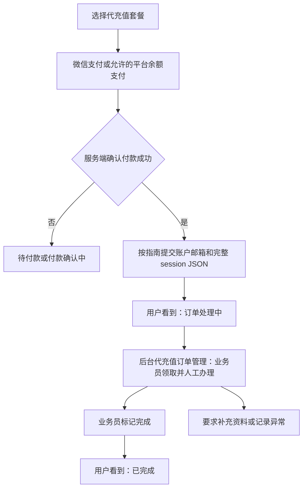

# Oak 厂商账户代充值实施方案

> 状态：人工处理版方案，待实施；本文不代表功能已上线。
>
> 编写时间：2026-11-03 04:04:24 +00:00。
>
> 修订时间：2026-11-03 04:42:17 +00:00；按用户要求改为业务员人工办理，保留微信及可配置余额支付。
>
> 范围：New API 前台、New API 后台和 New API 服务端。

## 1. 已确认方向与首期范围

New API 提供代充值商品、收款、账户资料提交和后台订单管理。用户选择套餐并付款，按指南提交 ChatGPT 邮箱及完整 session JSON；提交成功后，前台显示“订单处理中”。管理员和业务员在“代充值订单管理”页面人工办理，完成后将订单标记为已完成，用户看到相应结果。

**本版明确采用人工办理。**业务员根据订单资料在平台外完成实际充值，New API 不主动向上游提交资料，不对接供应商订单 API、查询或状态回调。供应商 API 文档、沙箱和密钥不再是本功能的实施前置条件。前台不展示上游受理、上游进度或上游订单号。

**微信支付首期必备；平台余额支付由管理员按商品配置是否允许，建议默认关闭。**微信直接结算代充值订单；余额支付扣除用户已有的 Oak 可用余额。该授权只作用于代充值商品，现有平台包月订阅支付规则保持原合同。

首期按已给出的流程提供 ChatGPT 套餐商品，一笔订单对应一个商品和一个目标账户。实际商品名称、周期、价格、适用账户条件和处理承诺由管理员填写。GPTLoad 继续承担模型账号和挂靠执行，本功能均落在 New API。

## 2. 当前项目依据

New API 已有钱包充值、平台订阅、微信支付渠道、发票和权限框架。`model/topup.go` 的钱包充值成功会增加平台额度，`model/subscription.go` 的订阅成功会开通平台订阅；代充值应使用独立商品和订单模型，复用支付底层能力，保留自己的人工处理状态。

现有权限代码包括 `common/constants.go` 的角色枚举、`service/authz/` 的资源/动作权限、`middleware/auth.go` 的路由鉴权，以及用户管理中的角色授予与会话撤销。当前独立财务角色只有财务资源能力；新增“业务员”可沿用这一模式，不必再建一套员工登录系统。

现有权限判断也包含数字角色阈值，例如财务角色 5、管理员 10。业务员需要新增独立角色和明确资源能力，不能靠放宽管理员路由门槛获取页面，否则容易顺带开放用户、财务或渠道管理。角色合法值、能力解析、侧边栏、路由和个人访问令牌范围都要同步接入。

首页入口在 `web/src/features/home/components/oak-services.tsx`，当前代充值仍指向采购联系区；钱包页同时展示平台余额充值与平台订阅。新增代充值页使用 `/recharge`，首页卡片链接到该页。部署资料描述 New API 原生服务和支付配置，但本轮没有核查线上商户配置；上线验收需要实际核实微信渠道。

## 3. 用户页面与操作

### 3.1 商品选择与支付

商品卡展示厂商、套餐名称/周期、售价与币种、适用账户要求、处理时效和售后说明。处理时效根据实际业务员排班和供货能力填写，不虚构自动到账承诺。付款确认页再次显示商品、实付金额和支付方式。

先付款再收集 session 信息，待支付订单不出现 session 输入项。支付区域按以下规则展示：

| 支付方式 | 前台展示与管理配置 |
| --- | --- |
| 微信支付 | 首期必备，默认选中；复用已配置支付网关的微信渠道。桌面扫码，移动端按渠道已支持的 H5/扫码能力展示；没有已接通的微信渠道时提示维护，正式开放销售前必须完成微信实付验收 |
| 平台余额 | 商品开启“允许平台余额支付”后展示，默认关闭；显示可用余额、本单扣款金额和预计剩余余额。余额不足时禁用付款按钮，提示改用微信支付 |

一期一笔订单只使用一种支付方式，全额微信或全额余额，不做组合支付。用户点击“确认使用余额支付”后服务端才扣款，不能选择商品就自动扣除。关闭余额开关后，前端隐藏入口，服务端也拒绝尚未完成的余额付款；已经扣款成功的订单继续履约。

微信支付可复用官方微信渠道或已配置支付网关的微信方式，沿用现有商户配置；不因允许余额支付而省略微信接入。当前没有配置可用微信渠道时，余额功能本地验证不能替代微信上线验收。

微信订单的发票沿用现有 CNY 开票选择与冻结报价。余额是已有资金，可能在原充值时已申请发票；首期建议余额消费订单仅提供付款明细，不重复开放开票或收取开票附加费。付款方式切换时同步重算报价并明确展示开票可用性；余额消费开票如需支持，须先确定原充值和本次消费的防重复开票规则。

### 3.2 付款后的信息提交

付款确认后，订单详情展示四步指南：

1. 在同一浏览器新标签打开 `https://chatgpt.com/`，登录需要充值的账号。
2. 在同一浏览器打开 `https://chatgpt.com/api/auth/session`。
3. 全选并复制该页面完整 JSON，返回 Oak 订单页。
4. 填写该账号邮箱，粘贴完整 JSON，确认本人有权委托充值后提交。

用户在提交前能看到用途说明：“资料仅用于办理本笔代充值，授权的订单处理人员可查看必要信息。”不要求提供密码、验证码或其他账号 Cookie。提交成功后清空输入框，服务端保存资料并将订单放入后台待处理队列；这一步完成即可显示“订单处理中”。页面刷新后，用户只能看到脱敏邮箱和资料提交时间，不回显 session。

领取后用户不能随意修改目标账户。业务员发现资料不完整、邮箱不一致或 session 失效时，点击“要求补充资料”并填写用户可见的原因；用户在原订单重交，原 session 被替换并清除。无需重新购买或再次付款。

### 3.3 用户状态

| 业务情况 | 用户看到的状态 | 用户可操作 |
| --- | --- | --- |
| 尚未付款或微信通知尚未到达 | 待付款 / 付款确认中 | 继续原单付款或刷新状态 |
| 已付款但未交资料 | 待提交账户信息 | 打开指南并提交 |
| 资料已提交，尚未领取或正在办理 | **订单处理中** | 查看订单和联系客服 |
| 业务员要求更新资料 | 需要补充资料 | 查看原因，在原订单补交 |
| 业务员确认办理完成 | 已完成 | 查看完成时间与处理说明 |
| 人工确认无法办理 | 处理异常 | 查看对用户的说明及售后进度 |
| 管理员审核后发起退款 / 已实际退回 | 退款处理中 / 已退款 | 查看退款方式和金额 |

后台“待领取”和“办理中”统一映射为前台“订单处理中”。完成、补资料和退款是本平台人工操作或真实收退款结果，不展示供应商内部状态。订单列表保留商品、金额、实际支付方式、订单号、时间和当前状态。

## 4. 后台管理与业务员角色

### 4.1 商品管理

管理员在“代充值商品管理”配置：商品名称、厂商、套餐周期、售价/币种、购买须知、处理时效、排序、上下架，以及“允许平台余额支付”开关。首期固定收集邮箱和 session JSON，不做任意动态表单。无需配置供应商 API、密钥或 SKU 映射。

新订单仅可购买上架商品；已付款订单保留下单时的商品、价格和须知快照。商品改价、下架或余额开关变化不改写已成功付款订单。业务员可以读取订单商品快照，不能改价、上下架或调整支付方式配置。

### 4.2 代充值订单管理

后台新增独立入口“代充值订单管理”，建议页面地址 `/recharge-orders`。管理员进入后查看全部订单；业务员默认看到“待领取”和“我的订单”，也能查看其他订单的最小状态摘要，便于判断是否已有同事办理。

列表按订单号、提交时间、商品、支付方式、处理状态和处理人筛选。列展示订单号、用户编号、商品、金额、付款时间、脱敏邮箱、状态、处理人、最后更新时间；待付款订单不可领取。默认优先显示最早提交但尚未处理的订单。

订单详情包含四个区域：

- **订单与付款：**商品快照、金额、支付方式、付款状态和时间，支付结果只读。
- **充值资料：**邮箱、资料提交时间、session 是否存在；取得处理权后可按需查看/复制完整邮箱和 session。
- **处理操作：**领取订单、开始/继续办理、要求补资料、标记完成、记录异常和提交退款申请。完成操作需确认实际已办理并填写简短结果说明；外部业务参考号可选，仅内部可见。
- **处理记录：**谁在何时领取、查看敏感资料、要求补交、完成或提出退款；内部备注和用户可见说明分开保存。

领取通过数据库条件更新执行，一笔订单同时只有一个处理人。业务员仅能修改本人领取的订单；管理员可填写原因后转派或接管。页面打开不等于领取成功，旧页面操作也必须重新校验处理人和版本，防止多人重复办理。转派前需由人工交接确认外部办理进度，系统不能保证撤回业务员已经在外部发起的动作。

业务员在平台外完成实际代充后回到订单页标记完成；平台只记录人工结果，不声称已通过供应商 API 验证。需要排查时可保留不含凭据的内部参考号或说明。已完成订单不能由业务员重新打开后再次办理。

### 4.3 角色与权限

新增独立内置角色 **“业务员”**，复用现有用户账号登录。建议由 Root 在用户管理中授予/撤销，沿用当前财务角色授予、敏感操作校验和会话撤销机制。

| 操作 | 普通用户 | 业务员 | 管理员 / Root |
| --- | --- | --- | --- |
| 查看本人购买记录、提交本人资料 | 允许 | 允许 | 允许 |
| 查看后台订单队列摘要 | 不允许 | 允许 | 允许 |
| 领取订单、处理订单、填写结果 | 不允许 | 仅本人领取的订单 | 全部订单，可接管/转派 |
| 查看/复制 session 和完整邮箱 | 不允许回读 session | 仅本人领取且仍需办理的订单 | 需明确操作，按相同敏感读取规则记录审计 |
| 商品编辑、售价、余额支付开关 | 不允许 | 不允许 | 管理员商品写权限 |
| 退款申请 | 本人可联系售后 | 可记录申请和原因 | 可审核并执行退款 |
| 修改支付状态、手工伪造收款成功 | 不允许 | 不允许 | 不提供此操作 |
| 系统设置、渠道、其他用户管理 | 不允许 | 不允许 | 按原管理权限 |
| 授予/撤销业务员角色、商户密钥设置 | 不允许 | 不允许 | Root，沿用现有授权规则 |

建议权限资源拆为 `recharge_orders`（读取、处理、敏感资料读取、转派、退款）和 `recharge_products`（读取、维护）。业务员只获得订单读取、处理和受订单归属限制的敏感读取；财务角色不因新功能自动获得 session 访问权限。退款资金动作单独授权给管理员，业务员的订单处理权限不能调用退款接口。

服务端检查角色、动作能力、订单处理人和状态，前端按返回能力显示菜单及按钮。业务员系统角色低于既有财务/管理员门槛；接入时检查所有数字阈值与能力解析，保证旧管理员覆盖或旧登录会话不会扩大权限。敏感资料读取首期仅允许网页登录会话并复用项目现有敏感操作校验，个人访问令牌不提供该能力。角色被撤销、账号被停用或订单被转派后，后续读取立即拒绝。

现有通用管理写审计按财务及以上的鉴权门槛启用；新增业务员路由需要显式接入相同审计能力，不能假定角色登录成功就已有记录。敏感读取单独记录动作元数据，并确认审计中间件不会捕获包含 session 的响应正文。

## 5. 数据和业务接口

### 5.1 模型与状态

- `AccountRechargeProduct`：商品展示、售价/币种、须知、启用/排序和 `allow_wallet_payment`。
- `AccountRechargeOrder`：购买用户、商品快照、订单号、金额、支付方式/状态、余额付款的冻结汇率和实际扣除整数、邮箱、session 密文、资料版本、处理状态、处理人、领取/完成时间、内部备注、用户可见说明及更新时间。
- 订单操作记录：订单 ID、操作者、动作、前后状态、时间和必要原因；不记录 session。扣款/退款流水按订单与动作唯一关联，保存金额与额度。

支付状态与人工处理状态分离。支付状态为待支付、成功、失败、过期、退款中、已退款；人工状态为 `awaiting_info`、`pending`（待领取）、`processing`、`action_required`、`completed`、`exception`、`cancelled`。`pending` 和 `processing` 对用户均显示“订单处理中”。

已付款并提交有效格式资料后才可进入待领取状态。领取、资料替换、完成、退款批准等操作校验当前状态和版本；提交资料与入队同事务完成，重复提交不得清除处理人或把完成订单重新入队。业务员提出退款不等于退款成功：管理员批准后锁住继续办理，执行资金动作，实际成功后更新退款状态。

### 5.2 收款与余额支付

用户下单时服务端读取启用商品、校验所选支付方式、冻结商品快照和金额，生成 Oak 订单。微信使用现有 New API 支付适配器和验签逻辑，成功通知按订单业务类型分流至 `AccountRechargeOrder`，不调用钱包充值或平台订阅开通函数。微信渠道必须完成创建订单、支付展示、验签回调、金额匹配、重复通知和继续支付的完整链路。

余额支付在实际扣款时重新校验商品的余额开关和用户状态。服务端将 CNY 应付金额按现有钱包币值规则换算为内部额度整数，使用统一的严格额度转换能力并冻结汇率及实际扣除值；不能把“元”直接作为 `quota`，不能使用模型倍率或钱包充值优惠重新打折。换算无效、超界或余额不足时明确拒绝，不能扣成负数。金额计算使用十进制，舍入规则复用项目钱包换算合同。

余额扣款、订单已付款、唯一扣款流水在同一数据库事务中提交，通过余额足够的条件更新和订单状态约束保证并发正确性。需核对现有模型请求扣款、批量写入与缓存路径，确保代充值不能消费已经被推理请求预留的余额，不能只用页面展示或缓存余额判断可支付。数据库提交后同步失效/更新钱包缓存，失败可见且可恢复；订单只读查询不再次扣款。支付接口超时、双击和重复请求复用同一业务幂等键，只能扣一次。

首期一旦为订单生成微信支付凭据，就锁定其支付方式，页面继续原单付款，不允许在有效微信订单上直接改为余额扣款。需要换方式时，先按网关能力关闭/查明原支付单；无法确认关闭则保持原方式。迟到支付通知必须核对真实收款，不能因为前台超时就丢弃，也不能造成第二次履约。

支付成功事务同步推进可选发票申请；余额支付按第 3.1 节提供消费明细。支付和人工处理两条状态互不冒充，处理员标记完成不能修改实付金额或收款状态。

### 5.3 API 轮廓

以下为方案路径，实施时按项目路由约定组织：

| API | 用途与权限 |
| --- | --- |
| `GET /api/account-recharge/products` | 查看上架商品与服务端可用支付方式 |
| `POST /api/account-recharge/orders` | 用户确认方式后创建订单、微信支付或原子余额扣款；业务幂等键防重复 |
| `GET /api/account-recharge/orders/self` | 本人订单列表 |
| `GET /api/account-recharge/orders/:id` | 本人订单摘要，不回显 session 或内部备注 |
| `POST /api/account-recharge/orders/:id/account-info` | 已付款、待提交或要求补充时提交本人资料 |
| `/api/account-recharge/admin/products` | 管理员商品配置 |
| `GET /api/account-recharge/operations/orders` | 业务员/管理员订单队列和筛选 |
| `GET /api/account-recharge/operations/orders/:id` | 按权限返回订单详情；默认不含 session |
| `POST /api/account-recharge/operations/orders/:id/claim` | 原子领取可处理订单 |
| `POST /api/account-recharge/operations/orders/:id/reveal-account-info` | 会话敏感校验 + 独立能力 + 处理人/状态校验后返回必要资料，记录不含凭据的审计 |
| `POST /api/account-recharge/operations/orders/:id/action` | 请求补资料、标记完成/异常或提出退款；服务端动作白名单 |
| `POST /api/account-recharge/operations/orders/:id/assign` | 管理员转派/接管，必须填写原因 |
| `POST /api/account-recharge/admin/orders/:id/refund` | 有退款权限的管理员审核、执行或核实原路退款；独立幂等处理 |

业务员接口采用专用能力鉴权，不能整体放进现有 `AdminAuth` 组再提高业务员角色来访问。用户归属来自当前会话；客户端不能指定订单所有者、处理人、实付或扣除额度。人工接口仅允许白名单动作和合法状态转移。

## 6. 账户信息查看与保存

本版为满足人工办理，允许获授权的处理人员读取完整邮箱和 session。读取范围限定到当前待办理订单，列表和普通详情不直接返回 session；业务员主动点击“查看充值资料”后，服务端完成权限校验、解密和审计，再展示/复制。

- session 视为认证凭据，使用认证加密存储，密钥来自服务端机密配置。缺少密钥时拒绝接收资料，不保存明文。
- 用户仅在订单页提交资料，服务端验证 JSON 格式、长度和邮箱格式，保存原始 JSON。接口响应使用 `Cache-Control: no-store`；敏感弹层关闭、离开页面或失去权限后清空前端内容。
- session 不进入日志、错误正文、埋点、审计内容、导出文件或浏览器持久存储；审计只记录“谁在何时查看了哪一单”。不提供批量导出账户资料。
- 使用明确的“复制”按钮协助业务员办理；已经由人员复制到剪贴板或外部服务的内容无法由 New API 撤回，转派和撤权只限制后续平台访问。
- 业务员请求补资料后停止旧资料读取，用户重新提交时清除旧密文；重交后保留原处理人，回到其待办，避免重新领取重复操作。
- 订单完成、取消或退款确认后清除当前数据库中的 session 密文，仅保留商品、交易和处理记录；终态不能再次查看凭据。结果尚待核对的订单保持 `processing`，只有当前处理人及获授权管理员能读取。备份中的历史密文按备份保留策略清理，不能宣称删除在线字段就清除了所有副本。

## 7. 异常、退款与人工操作约束

- **支付结果不确定：**微信查询原支付单/等待验签通知；余额查询原订单及扣款事务，不重复创建并扣款。
- **余额不足或开关关闭：**服务端拒绝扣款，用户可在未生成微信凭据且未成功付款前重新选择方式。
- **已付但资料未提交：**保留待提交状态，用户从原订单继续。
- **资料失效或账号不符：**业务员填写原因并要求补交，用户在同一笔已付订单重交。
- **多人同时领取或操作：**只有一个领取成功，后续写入校验处理人和状态版本；冲突时刷新订单，不重复执行外部办理。
- **外部办理结果不确定：**业务员在内部备注记录核对事项并继续核实，前台保持“订单处理中”；未确认前不重复充值、不标记完成，也不批准退款后继续办理。
- **无法完成代充：**业务员记录原因并提交管理员审核退款；管理员在确认外部办理未成功或已取消后执行退款，结果未知时先人工核对。微信按原支付渠道退款，原路退款能力尚未对接时由财务在网关完成并核实记录；余额支付按原单实际扣除的额度整数返还 Oak 钱包，汇率变化不影响返还数量。余额返还、唯一退款流水和已退款状态同事务提交，重复操作最多返还一次；不能将余额支付转成微信提现。返还超过钱包上限时保留退款待处理并告警，不截断金额或伪造成功。
- **误操作或人员离岗：**管理员根据处理记录接管/转派；完成和退款终态不能被旧页面或普通业务员重新打开。

退款操作需与人工处理状态串行校验。管理员批准退款后停止领取、完成和敏感资料读取，避免退款期间仍然办理；退款失败保留退款待处理并显示原因，不自动重新派单。

## 8. 实施落点与步骤

| 范围 | 代码位置与内容 |
| --- | --- |
| 商品与用户订单 | `web/src/features/account-recharge/` 和认证路由；首页代充值卡链接到 `/recharge` |
| 后台业务员页面 | 新增订单管理 feature/路由，包含队列、领取、资料弹层和处理动作 |
| 商品/订单/记录 | `model/` 新模型和事务，`model/main.go` 注册迁移 |
| 支付与退款 | `controller/` 和支付通知分流；核对 `model/user.go` 钱包写入/缓存、`common/quota_math.go` 严格转换；复用微信渠道 |
| 业务员权限 | `common/constants.go`、`service/authz/`、`middleware/`、用户角色管理与权限目录；侧边栏、前端路由、PAT 同步限制 |
| 处理接口与审计 | `router/api-router.go`、专用控制器和事务；受保护资料读取和操作记录 |
| 发票和说明 | 微信订单复用 invoice 快照；README 更新商品、业务员授权、办理及退款操作说明 |

建议依次实施：商品/订单与微信/余额支付 → 业务员角色与订单领取/资料读取/处理 → 用户提交与后台页面 → 数据库、权限、支付和人工业务闭环验证。无需供应商 API 适配器或 GPTLoad 变更。

该方案已获用户批准并实施于本地工作区；实际完成范围、验证结果和上线待办见第 12 节。生产部署前沿用现有备份与发布流程。

## 9. 验收标准

1. 用户付款、提交邮箱与 session 后立即看到“订单处理中”；后台同时出现可领取订单。用户界面不出现上游受理、进度、接口状态或订单引用。
2. 微信支付必备且端到端验证通过；平台余额按商品开关控制，余额不足、重复请求、并发模型消费和退款不会导致超扣或重复返还。
3. 普通用户只能读取本人订单；业务员只能读取后台队列摘要和获分配订单的敏感资料、执行允许的处理动作。通过直连 API、旧会话或 PAT 均不能绕过边界。
4. 业务员看得到“代充值订单管理”，能领取、查看/复制本人订单资料、要求补交和标记完成；无法管理商品、用户、渠道、支付设置或执行资金退款。
5. 两名业务员同时领取只有一人成功；转派或撤权后原处理人不能继续读取/修改；退款批准和完成互斥，旧页面不能覆盖新状态。
6. 标记完成前必须实际确认办理结果并填写说明；平台记录操作者、完成时间和原因，用户看到“已完成”。业务员填写内部备注不泄露给用户。
7. session 只通过受保护的敏感读取接口按需返回；用户摘要、列表、日志、普通详情、导出和审计正文均不包含凭据。完成、取消、退款确认或替换资料后，旧内容不再可读。
8. 微信原路退款以真实退款结果为准；余额退款返还原单实际扣除整数，汇率变化不影响返还。业务员提交退款申请不能直接改成已退款。
9. 三种支持数据库迁移兼容，钱包/平台订阅/财务原行为不受损；手机和桌面用户都能继续未完成订单。

## 10. 已确认与待补充信息

已确认：人工处理代充值；用户提交后显示“订单处理中”；后台提供“代充值订单管理”和“业务员”角色；微信必备；平台余额支付可配置。

本版建议业务员领取后处理本人订单，管理员管理全部订单并可转派；商品开关按商品配置，业务员角色由 Root 授予；处理结果由人工确认，退款资金动作由管理员执行。

仍需在实际运营前配置首期商品名称/周期、售价、账户要求、实际处理时效和售后规则，以及可用微信支付渠道。微信开票和余额消费的开票边界见第 3.1 节。**上游 API、密钥、Webhook 和沙箱不再列为待提供材料。**

## 11. 代码索引

- [产品现状](../memory/product.md)与[原挂靠实施记录](account-hosting.md)。
- [API 路由](../../router/api-router.go)、[钱包订单模型](../../model/topup.go)、[平台订阅模型](../../model/subscription.go)。
- [角色常量](../../common/constants.go)、[授权角色映射](../../service/authz/assignment.go)、[权限解析](../../service/authz/resolver.go)、[财务权限参考](../../service/authz/resources_finance.go)。
- [鉴权中间件](../../middleware/auth.go)、[用户角色管理](../../controller/user.go)、[首页服务卡](../../web/src/features/home/components/oak-services.tsx)。

## 12. 本地实施结果与验证

更新时间：2026-11-03 05:41:30 +00:00。用户已批准人工办理方案并授权实施；工作区位于 `oak` 分支，未提交、推送或部署生产。

### 已接入范围

- New API 用户页 `/recharge` 包含商品、微信/可选余额结账、本人订单、继续支付、资料提交和处理结果。首页代充值服务卡已指向此入口。
- `/recharge-products` 支持商品配置、排序、上下架及逐商品余额开关；`/recharge-orders` 提供订单号和状态筛选、我的待办、领取、补资料、内部备注、完成、异常、转派及退款。业务员默认仅有订单读写和敏感读取能力，Root 经单次验证授予/撤销该角色。
- `model/account_recharge.go` 保存商品、订单、版本及事件；`model/account_recharge_payment.go` 负责冻结金额、到账、余额扣款和退款；三张新表由 `model/main.go` 注册迁移。
- `controller/account_recharge.go` 与 `router/account_recharge.go` 接入业务 API；沿用支付适配器、发票快照、登录鉴权及单次验证。`service/account_recharge.go` 使用 AES-GCM 加密邮箱与完整 JSON，订单号作为关联数据。
- 不接供应商 API，不收上游回调，不展示上游状态。微信退款在网关人工执行后登记，余额退款直接返还原单额度。未接入真实厂商账号或执行代充值。

### 操作与配置

参阅 [中文说明的人工代充值章节](../../README.zh_CN.md#oak-人工代充值)。必须配置 `OAK_RECHARGE_DATA_KEY` 和可用微信渠道，创建实际商品并指定业务员后才可营业；不在源码、测试或说明中保存真实 session、商户密钥或账号资料。

API 相对方案做了小幅收敛：报价单独使用 `POST /quote`，创建 `/orders` 后由 `/orders/:id/pay` 支付；领取、转派等统一走 `/operations/orders/:id/action` 动作白名单。服务端仍独立检查转派和退款权限。用户/运营普通响应只返回安全摘要，敏感读取独立返回 `no-store`。

### 验证记录

- 三库：SQLite **3.50.4**、MySQL Community **8.4.2**、PostgreSQL **14.17 (Homebrew)**，均为本地隔离测试数据库。`TEST_MYSQL_DSN` / `TEST_POSTGRES_DSN` 配置回环测试实例后运行 `go test ./controller -run '^TestRecharge' -count=1 -v`。测试创建随机库并清理，仅使用虚构资料。
- 每库覆盖新建、已有钱包数据上的升级、连续迁移和再次启动迁移；核对存量金额、冻结额度、商品下架值和终态。覆盖重复下单/付款、余额开关复核、并发领取、转派、补资料保留处理人、终态清密文、金额不符与重复签名通知、微信退款记录。
- SQLite 与 Redis 测试实例额外覆盖模型预留额度不可重复消费、缓存不可用拒绝付款、退款入库后缓存失败及原单幂等恢复。鉴权测试使用正式网页登录会话与真实权限服务，覆盖单次证明、重放拒绝、业务员资金越权、历史管理员覆盖、旧会话撤销及审计脱敏。
- 前端使用实际页面、公共表单/弹窗和查询客户端，只替换 HTTP 边界，验证商品余额开关、报价绑定、session 提交后清理、业务员领取与资金按钮隔离、页面打开结账及权限查询失败收起入口。已修正页面布局未渲染弹层的问题。
- 最终六个后端包完整回归、前端 14 个测试文件共 103 项回归、TypeScript 类型检查、变更文件 lint、前后端生产构建全部通过；命令为 `go test ./controller ./router ./service/authz ./middleware ./service ./model -count=1`、`go build`、`bunx tsgo -b`、变更文件 `oxlint`、`bun run build`。

### 安全依据与验证边界

本轮复核 [OWASP ASVS 5.0.0](https://owasp.org/www-project-application-security-verification-standard/)、[Authentication Cheat Sheet](https://cheatsheetseries.owasp.org/cheatsheets/Authentication_Cheat_Sheet.html) 的敏感操作重验证，以及 [Session Management Cheat Sheet](https://cheatsheetseries.owasp.org/cheatsheets/Session_Management_Cheat_Sheet.html) 的权限变更会话失效、禁止缓存和日志排除凭据要求。实现复用既有会话/单次证明机制并增加订单版本和动作绑定；这是定向控制验证，不宣称完成整个 ASVS 认证。

本地签名通知验证不等于真实微信交易：商户实际下单/扫码或 H5、支付通知到达、退款到账仍需上线验收。原厂账号有效性和人工操作结果由业务员核实；没有自动验证 ChatGPT 登录或订阅成功。没有运行最低 MySQL/PostgreSQL 版本矩阵，已测试版本列于上文。数据库旧数据升级使用当前上一版已有模型的代表性数据，不包含生产全量副本。

## 13. 套餐展示与订单详情调整

更新时间：2026-11-03 06:37:36 +00:00。已在本地预览生效，保留用户测试数据，未部署 wdm。

商品及订单快照新增 summary（500 字符）、provider（80）、period（80）、delivery_time（160）、icon（128）；原 description 继续保存购买说明。空值可清除，后端去除首尾空白并验证长度。创建订单在锁定商品的事务中复制字段，历史订单不回填当前商品。

卡片、结账及订单详情复用 product-info.tsx，分开显示套餐简介、服务商、周期、预计时效与购买说明。卡片说明可展开；订单管理员反馈独立显示为补充资料原因或处理结果。既有 Dialog 限制高度，桌面左右两列独立滚动，手机单列整体滚动。内部备注与历史属于左侧信息区，处理动作属于右侧。商品编辑沿用 LobeIconField，支持模型广场同一图标键、搜索、预览与清空。

验证：

- 配置本地隔离实例 TEST_MYSQL_DSN、TEST_POSTGRES_DSN 后执行 `go test ./controller -run '^TestRecharge' -count=1` 通过。另用 `go test ./controller -run '^TestRechargeDatabaseMatrix$' -count=1 -v` 确认无跳过：SQLite 3.50.4、MySQL 8.4.2、PostgreSQL 14.17，每库新建与旧代充值表升级共六个场景通过。覆盖连续迁移、旧描述/金额/下架值/唯一订单号保留、新字段保存与清空、超长拒绝、订单快照不随商品编辑变化。
- `bun run test -- src/features/account-recharge` 七项通过，覆盖商品编辑与余额开关、字段清空、说明展开、结账、提交后清理、权限失败撤下入口、补资料反馈归属及长文案布局。`bunx tsgo -b`、定向 oxlint、`bun run build` 与后端 `go build` 通过。
- 实际浏览器验证桌面 1440×900 双栏和 390×844 手机布局，弹窗保持在视口内；手机可滚动至邮箱、JSON 和提交按钮，无横向溢出。图标选择器搜索 OpenAI 后显示品牌图标，未读取或提交真实会话。
- 升级本地后端前用 SQLite 在线备份保存 build/local-preview/preview-before-product-layout-*.db，独立环境配置与原用户数据保留。截图保存在该目录 screenshots/，不纳入版本控制。

## 14. 接单开关与就绪状态

更新时间：2026-11-03 07:48:22 +00:00。SSH 已恢复连接，仅只读核查线上：new-api 正常运行，但进程与 `/etc/new-api/new-api.env` 均未配置 OAK_RECHARGE_DATA_KEY。未修改线上环境、重启服务或发布本轮代码。

本地已实现 `/system-settings/billing/recharge`，沿用 Root 系统设置入口，保存 `recharge_setting.enabled`。页面分别显示 RechargeEncryptionReady、RechargePaymentReady、RechargeWeChatReady；三个字段只读且不返回任何密钥。密钥或支付确认缺失时拒绝重新启用，但允许随时关闭。微信渠道与商品余额权限仍沿用原配置。

默认 true 保留升级前行为。`configured` 是开关、加密和支付确认条件的交集，用户目录另返回 enabled 以区分主动暂停与部署未就绪。关闭后服务端拒绝新报价、新订单和待付款订单继续支付；同幂等键原单恢复、已付资料提交、办理、退款和支付通知继续。仅使用现有 options 表，无新增表或列；开关写入复用已有事务路径，持久化失败不会更新内存或返回成功。

验证：

- SQLite 3.50.4、MySQL 8.4.2、PostgreSQL 14.17 本地隔离实例，配置 TEST_MYSQL_DSN 与 TEST_POSTGRES_DSN 后执行 `go test ./controller -run '^TestRecharge' -count=1 -v`，全部通过且三库无跳过。新增 TestRechargeConfiguration 验证真假值持久化、重复迁移保留、只读标记不可写、非法值拒绝、密钥不回传、数据库失败不改变内存。HTTP 订单回归覆盖暂停后新购拒绝、原单恢复、合法支付完成和已付资料提交。
- `go test ./controller ./model -run 'Test.*Option' -count=1` 通过，保护原设置行为。
- `bun run test -- src/features/account-recharge src/features/system-settings/billing`：两个文件 11 项通过；`bunx tsgo -b`、定向 oxlint、`bun run build`、`go build` 通过。实际本地浏览器关闭并保存后，用户页显示暂停、购买按钮禁用、历史保留；重新开启保存成功，已恢复原状态。
- 新入口复用 SettingsSection、SettingsForm、SettingsSwitchField 与页头保存按钮，未新增依赖。已有测试数据库和本地环境文件保持不变；本地只为验收保存了一次关闭和一次开启。

上线准备：先核对线上当前版本和待处理资料，备份数据库及环境文件；确认首次配置密钥不会替换既有密文所需密钥后，生成并持久保存 32 字节随机密钥（Base64），与本轮前后端一同发布并重启 New API。实际生产写入与凭证配置需用户确认，不能只打开业务开关而忽略缺失密钥。

## 15. 订单内发票状态与下载

更新时间：2026-11-03 08:34:54 +00:00。本地实现及验收完成；等待本次提交推送后的自动发布结果。

买家代充值订单左栏“订单信息”下方新增独立“发票信息”，包含未申请说明，或申请状态、冻结抬头、实付开票金额、号码、财务备注及附件下载。沿用订单查询的轮询和刷新；只有 issued 且 has_file 才提供下载，文件缺失明确报错。桌面保持双栏，小屏按原弹窗单列滚动。

`GetRechargeOrder` 仅在本人详情按 trade_no、user_id、business_type=recharge 精确查询已有申请；状态不随代充值办理状态推断。响应只返回展示及下载所需摘要，不含税号、银行资料或附件路径；运营响应不新增税务访问。前端 `order-invoice.tsx` 复用既有状态映射、金额格式化、按钮和 `downloadUserInvoice`，不嵌入带独立分页的整个钱包发票列表。没有数据库结构、支付金额或财务状态流转变更。

验证：

- SQLite **3.50.4**、MySQL **8.4.2**、PostgreSQL **14.17** 本地隔离实例。配置 `TEST_MYSQL_DSN`、`TEST_POSTGRES_DSN` 后执行 `go test ./controller -run '^TestRecharge' -count=1 -v` 全部通过，新增 `TestRechargeOrderInvoice` 三库无跳过。覆盖五种状态、快照金额和抬头、摘要脱敏、他人订单拒绝、运营响应隔离、错误用户/业务关联、坏快照、丢失申请和未申请返回 null。
- `bun run test -- src/features/account-recharge src/features/wallet/__tests__/invoice-payment.test.tsx` 两文件 21 项通过。真实页面验证从待开票刷新为已开票、按申请 ID 下载、JSON 错误附件拒绝、其他状态和未申请呈现。`bunx tsgo -b`、变更文件 oxlint、`bun run build`、`go build -o build/local-preview/new-api .` 通过。
- 本地浏览器从真实后端读取演示订单；下载的演示 PDF 与服务器文件逐字节一致。390×844 下弹窗宽 358、高 733.44，scrollWidth=clientWidth，无横向溢出且发票区域可滚动访问。截图位于忽略目录 `build/local-preview/screenshots/recharge-invoice-{desktop,mobile}.jpg`。
- 为预览新增单独标注“本地演示”的订单和发票，未改动原订单和余额，未执行真实付款、开票或线上订单操作。添加前备份为 `build/local-preview/preview-before-invoice-demo.db`；演示记录标识保存在该目录 `invoice-demo.json`，不是产品启动时自动创建的数据。
